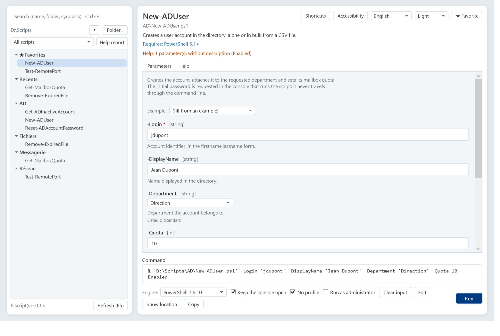
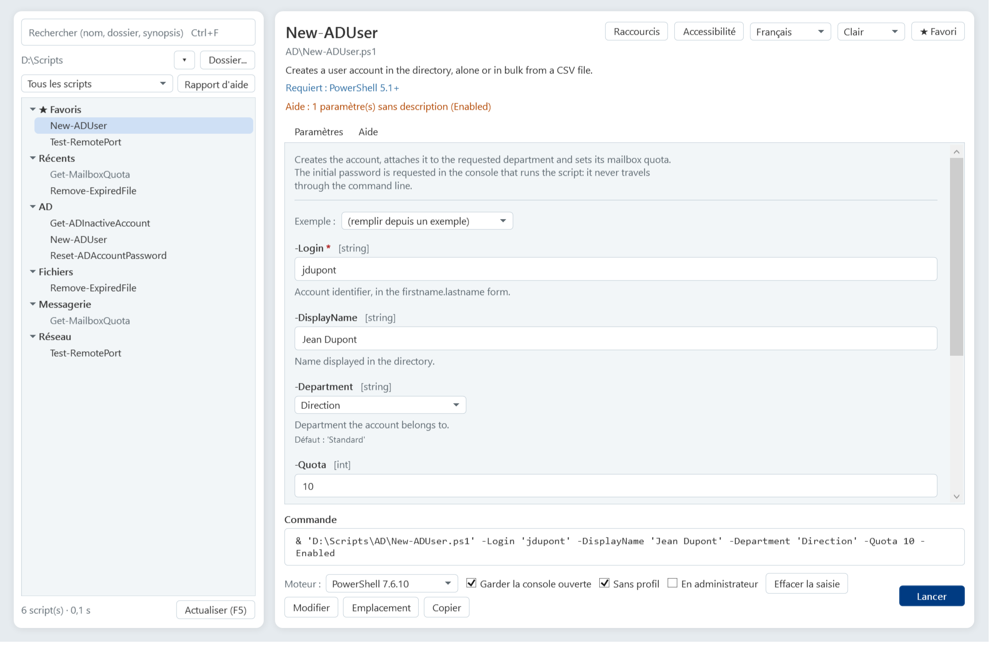
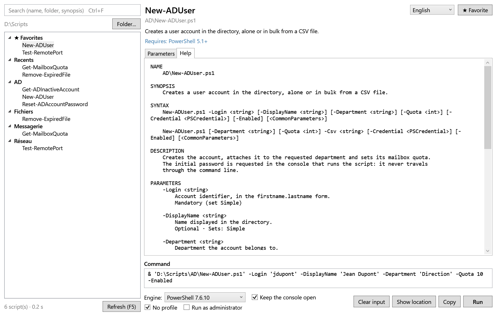
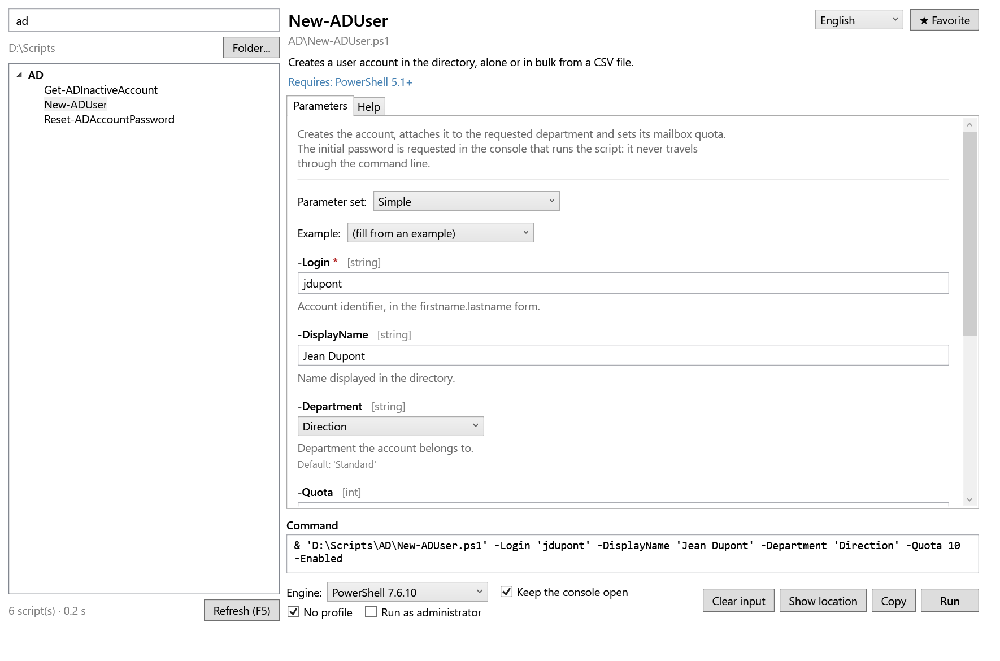
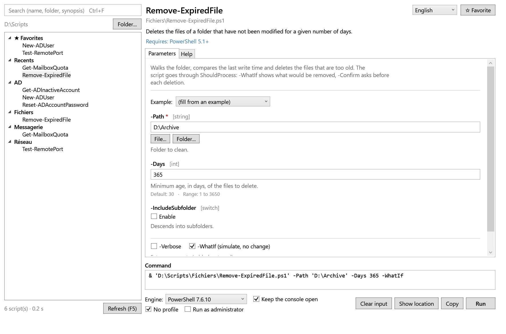

# PSScriptLauncher

[](https://github.com/Arnaud-Ferriere/PSScriptLauncher/actions/workflows/tests.yml)

`Show-Command` and `Get-Help` have made a baby, and the little bugger took steroids.
It's built on what each script already contains: its `param()` block and its comment-based help.
The script is self sufficient : no .exe or server to install.



## Features

- **Automatic inventory** of the folder and its subfolders, in the background. Scripts are read by
  syntax analysis (AST): **they are never executed while being read**.
- **Form generated** from `param()`:
  - parameter sets, mandatory fields, aliases, default values;
  - `ValidateSet` and enums as lists, multiple choice for arrays;
  - `ValidateRange` and `ValidatePattern` checked while typing;
  - "File..." / "Folder..." buttons for `*Path`, `*File`, `*Folder` parameters;
  - `PSCredential` and `SecureString` asked for at launch time, never passed in clear text.
- **Built-in help**: synopsis and description at the top, full help in the `Get-Help -Full` style.
  Descriptions written as comments inside `param()` are reused, exactly as `Get-Help` does.
- **Fill from an `.EXAMPLE`**: a click on one of the help examples fills the form.
- **Favorites, recent scripts and last input** of each script, kept per user.
- **Search** by name, folder or synopsis, ignoring case and accents.
- **Launch in a new console** (Windows PowerShell 5.1 or PowerShell 7, chosen from `#Requires`),
  elevated when needed. The generated command can also be copied.
- **Help diagnostics**: a help block that `Get-Help` ignores because of a formatting detail (missing
  blank line after `#Requires`, help placed after `using`...) is still displayed, with a warning
  that tells you what to fix.

## Requirements

- Windows, with Windows PowerShell 5.1 or PowerShell 7+.
- An STA session (the default in both consoles) and `FullLanguage` language mode (WPF cannot be used
  in `ConstrainedLanguage`, for example under a strict AppLocker or WDAC policy).

## Installation

1. Copy `Show-PSScriptLauncher.ps1` and the `PSScriptLauncher` folder to the root of the script
   folder you want to present.
2. If the files come from a download, unblock them:

   ```powershell
   Get-ChildItem -Recurse -File | Unblock-File
   ```

3. If script execution is disabled (`Restricted` policy, the default on a client machine), allow at
   least the session:

   ```powershell
   powershell.exe -ExecutionPolicy Bypass -File .\Show-PSScriptLauncher.ps1
   ```

   For a permanent change: `Set-ExecutionPolicy -Scope CurrentUser RemoteSigned`. Be responsible when using that !

## Usage

```powershell
.\Show-PSScriptLauncher.ps1                                  # the launcher's own folder
.\Show-PSScriptLauncher.ps1 -Path D:\Scripts                 # another folder
.\Show-PSScriptLauncher.ps1 -Path D:\Scripts -Language fr     # French interface
.\Show-PSScriptLauncher.ps1 -ExcludePattern '*.Tests.ps1', 'Lib\*' # PSScriptLauncher will list the scripts excluding the patterns selected
```

The analyzed folder is the launcher's own, or the one given to `-Path`. It is shown under the
search box and can be changed while the window is open, without restarting: **Folder...** button
or `Ctrl+O`.

A shortcut is recommended to hide the launcher's console:

```text
powershell.exe -NoProfile -WindowStyle Hidden -File "<folder>\Show-PSScriptLauncher.ps1"
```

Keyboard shortcuts: `Ctrl+O` (folder), `Ctrl+F` (search), `F5` (refresh), `Ctrl+Enter` (run).

## Languages

The interface is available in English and French. It follows the Windows UI language on first
run, can be changed at any time from the selector at the top right of the window (the choice is
remembered), or forced with `-Language en|fr`.

Every string lives in `PSScriptLauncher\Lang\<code>\*.psd1`, one catalog per language and per
area (window, form, analysis, command, help). Adding a language means adding a folder: the
catalog is loaded at startup and a missing key is reported in the tests.

**Missing your language? Feel free to open a pull request with a new catalog or an issue with
your translated files attached, if you would rather not touch Git.**

### Translating the interface

1. Copy the `PSScriptLauncher\Lang\en` folder to `PSScriptLauncher\Lang\<code>` (for example
   `Lang\de`).
2. Translate the **values only**: keys are flat, identical in every catalog, and the test suite
   fails as soon as one is missing on either side.
3. Declare the code in `Private\Text.ps1` (`Get-UiLanguageName`, with the language's own name:
   `Deutsch`) and in the `FileList` of `PSScriptLauncher.psd1`.
4. Keep the files UTF-8 with BOM and CRLF, then run
   `Invoke-Pester -Path .\PSScriptLauncher\Tests`: the catalogs, the keys referenced by the code
   and the number formatting (`0.5` vs `0,5`) are already checked.
5. Open a pull request against `main`. If Git is not your thing, open an issue and attach the
   `.psd1` files: I will integrate them for you.

Nothing to install to get started: in the GitHub web interface, **Add file → Create new file**
and type `PSScriptLauncher/Lang/de/window.psd1` (the slashes create the folders) then GitHub
offers to open the pull request for you.

Thanks !



## Saved data

Favorites, recent scripts and the last input run of each script are written to
`%LOCALAPPDATA%\PSScriptLauncher\state.json`, that is, in the profile of the logged-on user.
Nothing is written in the script folder: on a shared folder, everyone keeps their own preferences.

Never stored: passwords and credentials (`PSCredential`, `SecureString`), nor the values of
parameters whose name suggests a secret (`Password`, `Token`, `Secret`, `ApiKey`...).

## Writing scripts that display well

The launcher follows the `Get-Help` rules. They can get pesky, so a few points will make all the difference:

```powershell
#Requires -Version 5.1

<#
.SYNOPSIS
    One sentence: it appears in the tree and at the top of the form.
.DESCRIPTION
    The details, displayed under the synopsis.
.PARAMETER UserPrincipalName
    Describes the parameter (a comment line right before the parameter also works).
.EXAMPLE
    .\Set-Something.ps1 -UserPrincipalName user@contoso.com -Level 3

    Examples that call the script can fill the form in one click.
#>
[CmdletBinding(SupportsShouldProcess)]       # -WhatIf and -Verbose offered in the form
param(
    [Parameter(Mandatory)]
    [string]$UserPrincipalName,

    [ValidateRange(1, 5)]
    [int]$Level = 1,

    [ValidateSet('Standard', 'Admin')]
    [string]$Profile = 'Standard'
)
```

- Leave **a blank line** between `#Requires` (or any other comment) and the help block.
- Place the help block **before** `using` statements.
- If the script starts with a function, leave **two blank lines** between the help and the function,
  otherwise `Get-Help` assigns the help to the function. Don't ask me 🤷

## Development

```text
Show-PSScriptLauncher.ps1         entry point
PSScriptLauncher/
  PSScriptLauncher.psd1 / .psm1  module (one public command: Show-PSScriptLauncher)
  MainWindow.xaml                WPF window
  Private/
    Settings.ps1                 settings
    Text.ps1                     interface language and string catalogs
    Analysis.ps1                 AST reading of scripts (no WPF)
    Command.ps1                  value conversion, validation, launching
    HelpText.ps1                 help formatting
    UserState.ps1                favorites, recents, last inputs
    Ui.Form.ps1 / Ui.Window.ps1  form and window
  Lang/
    en/ fr/                      interface catalogs, one folder per language
  Tests/                         Pester tests (no UI)
```

Tests (Pester 5.2 or later; Windows PowerShell 5.1 ships with Pester 3):

```powershell
Install-Module Pester -Scope CurrentUser -Force -SkipPublisherCheck
Invoke-Pester -Path .\PSScriptLauncher\Tests
```

CI ([`tests.yml`](.github/workflows/tests.yml)) runs on every push to `main` and on pull requests:
Pester on **Windows PowerShell 5.1 and PowerShell 7**, PSScriptAnalyzer with the repository settings,
and a check that every `.ps1`/`.psm1`/`.psd1` stays UTF-8 with BOM and CRLF.

Static analysis:

```powershell
Invoke-ScriptAnalyzer -Path . -Recurse -Settings .\PSScriptLauncher\PSScriptAnalyzerSettings.psd1
```

Files are UTF-8 with BOM and CRLF line endings (`.gitattributes`), which Windows PowerShell 5.1
needs to read accents correctly.

## Screenshots

Built-in help, formatted like `Get-Help -Full`:



Search by name, folder or synopsis (case- and accent-insensitive):



`Path`-style parameters get "File..." and "Folder..." buttons; `SupportsShouldProcess` scripts get a
`-WhatIf` box:



## Known limitations

- Dynamic parameters (`DynamicParam`) are not displayed.
- `ValidateLength`, `ValidateCount` and `ValidateScript` are not checked in the form.
- The last input kept is the one from the last **run**.

## Similar tools

- [`Show-Command`](https://learn.microsoft.com/en-us/powershell/module/microsoft.powershell.utility/show-command):
  built into PowerShell, one command at a time, no folder browsing.
- [ScriptRunner](https://www.scriptrunner.com/) and
  [PowerShell Universal](https://ironmansoftware.com/powershell-universal): web platforms with a
  server, delegation, rights and auditing. Better suited for handing scripts to non-admin users.
- [PSScriptMenuGui](https://github.com/dan-osull/PowerShell-Script-Menu-Gui): a button menu
  described in a CSV, with fixed arguments.

## License

[MIT](LICENSE).

While not mandatory, a credit is always appreciated — mention **Arnaud FERRIERE**
([surlesnuages.fr](https://surlesnuages.fr)) if you want to thank me :)

GitHub renders a **Cite this repository** button (APA, BibTeX) from the
[`CITATION.cff`](CITATION.cff) file shipped at the root of this repository.
