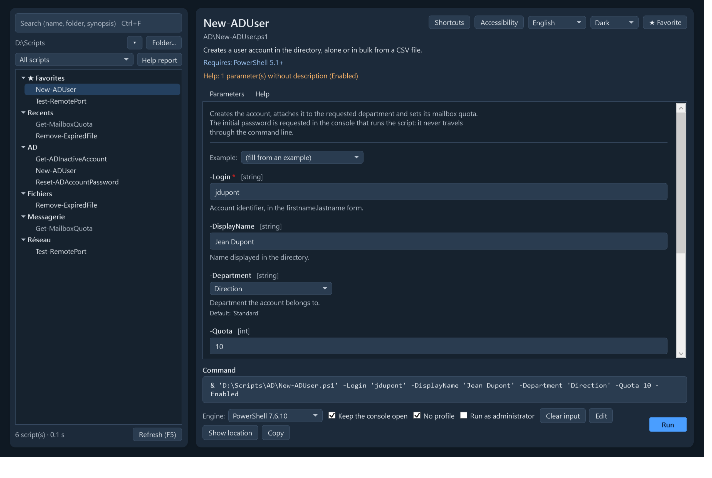
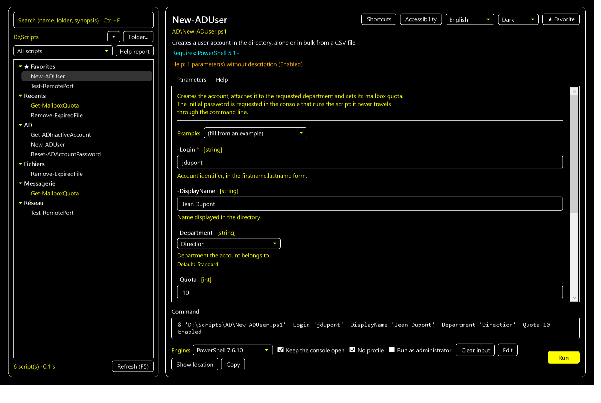
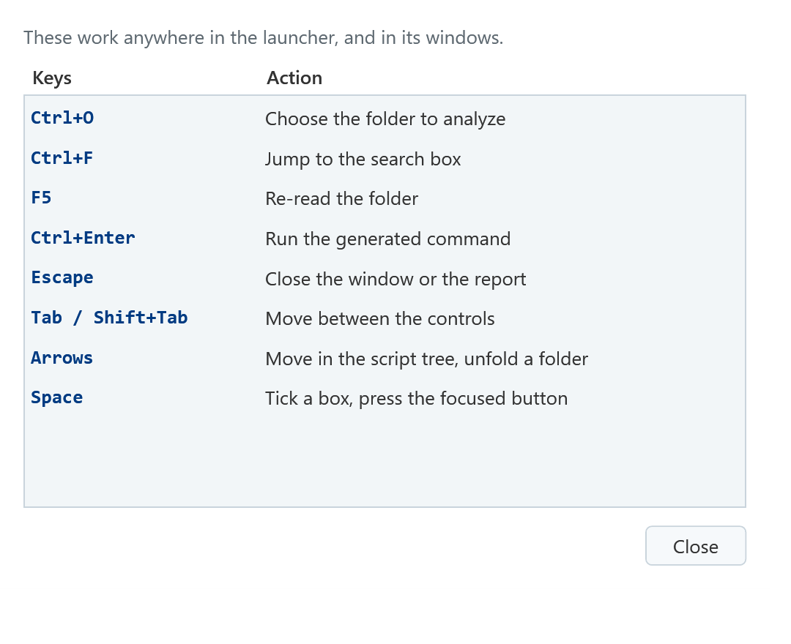
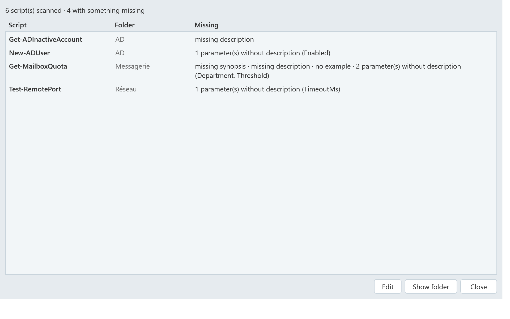

# PSScriptLauncher

[](https://github.com/Arnaud-Ferriere/PSScriptLauncher/actions/workflows/tests.yml)

`Show-Command` and `Get-Help` have made a baby, and the little bugger took steroids.

**TL;DR:** PSScriptLauncher is a GUI that lists every script in a folder and its subfolders, shows their built-in help and the parameters you can set, plus some quality-of-life touches.
You'll see the generated command at the bottom of the window, and you decide whether to run it or copy it.

It's built on what each script already contains: its `param()` block and its comment-based help.
The script is self-sufficient: nothing to install, no .exe, no server.


## Table of contents

- [PSScriptLauncher](#psscriptlauncher)
  - [Table of contents](#table-of-contents)
  - [Features](#features)
    - [Finding your scripts](#finding-your-scripts)
    - [Filling the form](#filling-the-form)
    - [Reading and improving the help](#reading-and-improving-the-help)
  - [Screenshots](#screenshots)
  - [Requirements](#requirements)
  - [Installation](#installation)
  - [Usage](#usage)
  - [Help report](#help-report)
  - [Writing scripts that display well](#writing-scripts-that-display-well)
  - [Languages](#languages)
    - [Translating the interface](#translating-the-interface)
  - [Accessibility](#accessibility)
  - [Saved data](#saved-data)
  - [Development](#development)
  - [Known limitations](#known-limitations)
  - [Similar tools](#similar-tools)
  - [License](#license)
  - [Show some love](#show-some-love)

## Features

### Finding your scripts

- **Automatic inventory** of the folder and its subfolders, in the background. Scripts are read by
  syntax analysis (AST): **they are never executed while being read**.
- **Instant start**: the tree is painted from a per-folder cache (name, synopsis, warnings, help
  gaps) while the inventory silently re-reads the files that changed.
- **Recent folders**: the launcher reopens the last folder you used, and a small menu keeps the six
  last ones one click away. Each folder keeps its own cache, so switching back is instant.
- **Global search** in the name, the folder, the synopsis, the description, the parameters and
  their descriptions, the examples and the rest of the help block, ignoring case and accents.
  Results are grouped by what matched, so a script never shows up without a reason.
- **Favorites and recent scripts**, kept per user and pinned at the top of the tree.

### Filling the form

- **Form generated** from `param()`:
  - parameter sets, mandatory fields, aliases, default values;
  - `ValidateSet` and enums as lists, multiple choice for arrays;
  - `ValidateRange` and `ValidatePattern` checked while typing;
  - "File..." / "Folder..." buttons for `*Path`, `*File`, `*Folder` parameters;
  - `PSCredential` and `SecureString` asked for at launch time, never passed in clear text.
- **Fill from an `.EXAMPLE`**: a click on one of the help examples fills the form.
- **Last input** of each script, kept per user and offered again next time.
- **Launch in a new console** (Windows PowerShell 5.1 or PowerShell 7, chosen from `#Requires`),
  elevated when needed, with `-NoProfile`, `-NoExit` and `-WhatIf` within reach. The generated
  command can also be copied instead of run.
- **Edit on the spot**: the displayed script opens in VS Code (or notepad) without leaving the
  launcher, next to the **Show folder** button that reveals it in Explorer.

### Reading and improving the help

- **Built-in help**: synopsis and description at the top, full help in the `Get-Help -Full` style.
  Descriptions written as comments inside `param()` are reused, exactly as `Get-Help` does.
- **Help diagnostics**: a help block that `Get-Help` ignores because of a formatting detail (missing
  blank line after `#Requires`, help placed after `using`...) is still displayed, with a warning
  that tells you what to fix.
- **Unknown help sections**: a single `.TAG`-style section that `Get-Help` does not know makes it
  ignore the whole block. The launcher shows the help anyway and names the sections to remove.
- **Help audit**: a filter keeps only the scripts whose help lacks something (synopsis, description,
  example, or parameter descriptions) and the **Help report** lists them all in one window. See
  [Help report](#help-report) below.

## Screenshots

Built-in help, formatted like `Get-Help -Full`:


Search by name, folder or synopsis (case- and accent-insensitive):


`Path`-style parameters get "File..." and "Folder..." buttons; `SupportsShouldProcess` scripts get a
`-WhatIf` box:


Light and dark themes, taken from the palette of [surlesnuages.fr](https://surlesnuages.fr): the
selector follows Windows by default, and the choice is remembered.



For vision issues, the **Accessibility** menu switches the window to a black, white and yellow
high-contrast palette, enlarges the text up to 150 % and thickens the focus outline:



## Requirements

- Windows, with Windows PowerShell 5.1 or PowerShell 7+.
- An STA session (the default in both consoles) and `FullLanguage` language mode (WPF cannot be used
  in `ConstrainedLanguage`, for example under a strict AppLocker or WDAC policy).

## Installation

1. Copy `Show-PSScriptLauncher.ps1` and the `PSScriptLauncher` folder to the root of the script
   folder you want to present.
2. If the files come from a download, unblock them:

   ```powershell
   Get-ChildItem -Recurse -File | Unblock-File
   ```

3. If script execution is disabled (`Restricted` policy, the default on a client machine), allow at
   least the session:

   ```powershell
   powershell.exe -ExecutionPolicy Bypass -File .\Show-PSScriptLauncher.ps1
   ```

   For a permanent change: `Set-ExecutionPolicy -Scope CurrentUser RemoteSigned`. Be careful when you do that!

## Usage

```powershell
.\Show-PSScriptLauncher.ps1                                             # the last folder used
.\Show-PSScriptLauncher.ps1 -Path D:\Scripts                            # another folder
.\Show-PSScriptLauncher.ps1 -Path D:\Scripts -Language fr               # French interface
.\Show-PSScriptLauncher.ps1 -ExcludePattern '*.Tests.ps1', 'Lib\*'      # also excludes those
```

| Parameter | Purpose |
| --- | --- |
| `-Path` | Folder to scan. Default: the last one opened, else the launcher's own folder. |
| `-ExcludePattern` | Wildcards excluded from the inventory, for scripts that are not meant to be run directly. |
| `-StatePath` | Where to keep preferences and cache. Default: `%LOCALAPPDATA%\PSScriptLauncher\state.json`. |
| `-Language` | `en` or `fr`. Default: the Windows UI language, then the last choice. |

The analyzed folder is the last one opened, or the launcher's own on first run; `-Path` always
wins. It is shown under the search box and can be changed while the window is open, without
restarting: **Folder...** button or `Ctrl+O`. The **▾** menu next to it lists the six last folders,
each of which keeps its own cache.

You can use a shortcut if you want to hide the launcher's console:

```text
powershell.exe -NoProfile -WindowStyle Hidden -File "<folder>\Show-PSScriptLauncher.ps1"
```

Keyboard shortcuts: `Ctrl+O` (folder), `Ctrl+F` (search), `F5` (refresh), `Ctrl+Enter` (run), `Tab`
between the controls, arrows in the tree, `Escape` to close a window. The **Shortcuts** button
opens the same list inside the app:



## Help report

It's nice to have a list of scripts, but you may wonder *which ones are badly documented?*
So did I ! 
The launcher answers it with the four things it can actually show :

| Gap | What the user loses |
| --- | --- |
| **Synopsis** | nothing in the tree: a bare name, no tooltip, invisible to the synopsis search |
| **Description** | no introduction in the Parameters tab nor in the help page |
| **Example** | no one-click fill from a `.EXAMPLE` |
| **Parameter description** | a field asking for a value without saying what it is for |

The filter above the tree narrows the list to any of those (or to all of them at once) and the
selected script spells out what it is missing, in orange, right under its synopsis:

```text
Help: missing description · 3 parameter(s) without description (NoConsoleLog, NoMarkdownLog, NoProgressBar) · no example
```

The **Help report** window does the same for the whole folder, with the parameter names, and two
buttons to act on it: **Edit** and **Show folder**. Fix, refresh, watch the list shrink.



## Writing scripts that display well

The launcher follows the `Get-Help` rules. They can get pesky, so a few points make all the difference:

```powershell
#Requires -Version 5.1

<#
.SYNOPSIS
    One sentence: it appears in the tree and at the top of the form.
.DESCRIPTION
    The details, displayed under the synopsis.
.PARAMETER UserPrincipalName
    Describes the parameter (a comment line right before the parameter also works).
.EXAMPLE
    .\Set-Something.ps1 -UserPrincipalName user@contoso.com -Level 3

    Examples that call the script can fill the form in one click.
#>
[CmdletBinding(SupportsShouldProcess)]       # -WhatIf and -Verbose offered in the form
param(
    [Parameter(Mandatory)]
    [string]$UserPrincipalName,

    [ValidateRange(1, 5)]
    [int]$Level = 1,

    [ValidateSet('Standard', 'Admin')]
    [string]$Profile = 'Standard'
)
```

- Leave **a blank line** between `#Requires` (or any other comment) and the help block.
- Place the help block **before** `using` statements.
- If the script starts with a function, leave **two blank lines** between the help and the function,
  otherwise `Get-Help` assigns the help to the function. Don't ask me 🤷

## Languages

The interface is available in English and French. It follows the Windows UI language on first
run, can be changed at any time from the selector at the top right of the window (the choice is
remembered), or forced with `-Language en|fr`.

Every string lives in `PSScriptLauncher\Lang\<code>\*.psd1`, one catalog per language and per
area (window, form, analysis, command, help). Adding a language means adding a folder: the
catalog is loaded at startup and a missing key is reported in the tests.

**Missing your language? Feel free to open a pull request with a new catalog or an issue with
your translated files attached, if you would rather not touch Git.**

### Translating the interface

1. Copy the `PSScriptLauncher\Lang\en` folder to `PSScriptLauncher\Lang\<code>` (for example
   `Lang\de`).
2. Translate the **values only**: keys are flat, identical in every catalog, and the test suite
   fails as soon as one is missing on either side.
3. Declare the code in `Private\Text.ps1` (`Get-UiLanguageName`, with the language's own name:
   `Deutsch`) and in the `FileList` of `PSScriptLauncher.psd1`.
4. Keep the files UTF-8 with BOM and CRLF, then run
   `Invoke-Pester -Path .\PSScriptLauncher\Tests`: the catalogs, the keys referenced by the code
   and the number formatting (`0.5` vs `0,5`) are already checked.
5. Open a pull request against `main`. If Git is not your thing, open an issue and attach the
   `.psd1` files: I will integrate them for you.

Nothing to install to get started: in the GitHub web interface, **Add file → Create new file**
and type `PSScriptLauncher/Lang/de/window.psd1` (the slashes create the folders) then GitHub
offers to open the pull request for you.

Thanks!


## Accessibility

Keyboard: `Ctrl+O` (folder), `Ctrl+F` (search), `F5` (refresh), `Ctrl+Enter` (run), `Tab` between
the controls, arrows in the tree, `Escape` to close the report.

An **Accessibility** button next to the language and theme selectors opens the display settings,
each one remembered per user:

- **High contrast** :  black, white and yellow, independent of the light/dark choice, with an outline
  around the cards since both surfaces are black.
- **Dyslexia-friendly font** :  OpenDyslexic, used when it is installed on the computer (the entry
  explains why it is greyed out otherwise).
- **Text size** :  100, 115, 130 or 150 %, applied to the whole window.
- **Reduce animations** :  a static progress bar, and hover highlights that only react on click.
- **Thicker focus outline** :  a permanent 2 px ring around the focused control.
- **Roomier form** :  more space between the parameter blocks.

Under the hood:

- **Screen readers** :  every control is named: parameter fields announce the parameter name and
  read its description as help text; the search, the filters, the language and the theme pickers,
  the tree and the command box all have a name. Colour is never the only signal: a script without
  help or with a warning also exposes that state to the accessibility layer.
- **Status bar** :  a live region: its updates are announced instead of being silently redrawn.
- **Contrast** :  the three palettes are checked against WCAG AA (4.5:1), and the check runs in the
  CI along with the control names: `Describe 'Accessibility'` in the test suite.
- **Window size** :  capped to the work area, so the action buttons stay reachable on a small screen.

**Did I miss anything ?**: As with all of my work, I want it to be accessible to anyone. Please open an issue if you need something, I'll get to it! [Issues](https://github.com/Arnaud-Ferriere/PSScriptLauncher/issues)

## Saved data

Favorites, recent scripts, recent folders, the last input run of each script, the language, the
theme and the accessibility settings are written to `%LOCALAPPDATA%\PSScriptLauncher\state.json` (in the profile of the logged-on user).
Nothing is written in the script folder, on a shared folder everyone keeps their own preferences.

Never stored: passwords and credentials (`PSCredential`, `SecureString`), nor the values of
parameters whose name suggests a secret (`Password`, `Token`, `Secret`, `ApiKey`...).

The catalog cache of each analyzed folder lives next to the state file, in
`%LOCALAPPDATA%\PSScriptLauncher\cache\`: one file per folder, holding a size, a date, a synopsis,
a warning count and the help gaps per script. Nothing sensitive, and deleting the folder only makes
the next start slower again.

## Development

```text
Show-PSScriptLauncher.ps1         entry point
PSScriptLauncher/
  PSScriptLauncher.psd1 / .psm1  module (one public command: Show-PSScriptLauncher)
  MainWindow.xaml                WPF window, styles and templates
  HelpReportWindow.xaml          help report window
  PSScriptAnalyzerSettings.psd1  analyzer rules used by the CI
  Private/
    Settings.ps1                 settings
    Text.ps1                     interface language and string catalogs
    Theme.ps1                    palettes, fonts and accessibility settings
    Analysis.ps1                 AST reading of scripts (no WPF)
    Command.ps1                  value conversion, validation, launching
    HelpText.ps1                 help formatting
    UserState.ps1                favorites, recents, last inputs, preferences
    Cache.ps1                    per-folder cache: instant first paint
    Ui.Form.ps1 / Ui.Window.ps1  form and window
    Ui.Report.ps1                help report window
  Lang/
    en/ fr/                      interface catalogs, one folder per language
  Tests/                         Pester tests (window built headless, no display)
```

Tests (Pester 5.6.1 or later; Windows PowerShell 5.1 ships with Pester 3):

```powershell
Install-Module Pester -Scope CurrentUser -Force -SkipPublisherCheck
Invoke-Pester -Path .\PSScriptLauncher\Tests
```

CI ([`tests.yml`](.github/workflows/tests.yml)) runs on every push to `main` and on pull requests:
Pester on **Windows PowerShell 5.1 and PowerShell 7**, PSScriptAnalyzer with the repository settings,
and a check that every `.ps1`/`.psm1`/`.psd1` stays UTF-8 with BOM and CRLF.

Static analysis:

```powershell
Invoke-ScriptAnalyzer -Path . -Recurse -Settings .\PSScriptLauncher\PSScriptAnalyzerSettings.psd1
```

Files are UTF-8 with BOM and CRLF line endings (`.gitattributes`), which Windows PowerShell 5.1
needs to read accents correctly.

## Known limitations

- Dynamic parameters (`DynamicParam`) are not displayed.
- `ValidateLength`, `ValidateCount` and `ValidateScript` are not checked in the form.
- The last input kept is the one from the last **run**.
- Dependencies are not followed: a script that dot-sources helper files shows its own parameters,
  not theirs.

## Similar tools
I made PSLauncher because no other script did precisely what I needed, but you might want to see what others have done. 
I suggest to look a bit the following tools that might be of interest!
- [`Show-Command`](https://learn.microsoft.com/en-us/powershell/module/microsoft.powershell.utility/show-command):
  built into PowerShell, you probably already know it.
- [ScriptRunner](https://www.scriptrunner.com/) and
  [PowerShell Universal](https://ironmansoftware.com/powershell-universal): web platforms with a
  server, delegation, rights and auditing. Better suited for handing scripts to non-admin users.
- [PSScriptMenuGui](https://github.com/dan-osull/PowerShell-Script-Menu-Gui): a button menu
  described in a CSV, with fixed arguments.

## License

[MIT](LICENSE).

While not mandatory, a credit is always appreciated : mention **Arnaud FERRIERE**
([surlesnuages.fr](https://surlesnuages.fr)) if you want to thank me 🩵

GitHub renders a **Cite this repository** button (APA, BibTeX) from the
[`CITATION.cff`](CITATION.cff) file shipped at the root of this repository.

## Show some love

If this launcher helps you, here are a few ways to show appreciation:

- Star the repo (it will help with discoverability)
- Report a bug or suggest an idea in [Issues](https://github.com/Arnaud-Ferriere/PSScriptLauncher/issues)
- **Missing your language?** A new catalog is one folder away: see [Languages](#languages)
- Tell me how you use it, I would love to see the scripts you drive with it!

If it saved you some time, a coffee is always appreciated!

[](https://ko-fi.com/surlesnuages)

None of this is required. Enjoy the launcher and get documenting! ⛅
